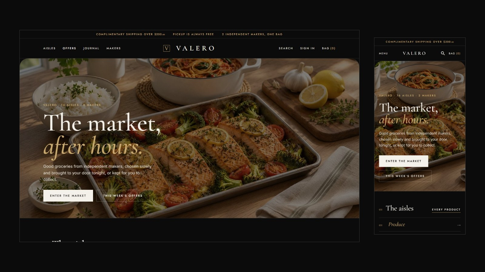
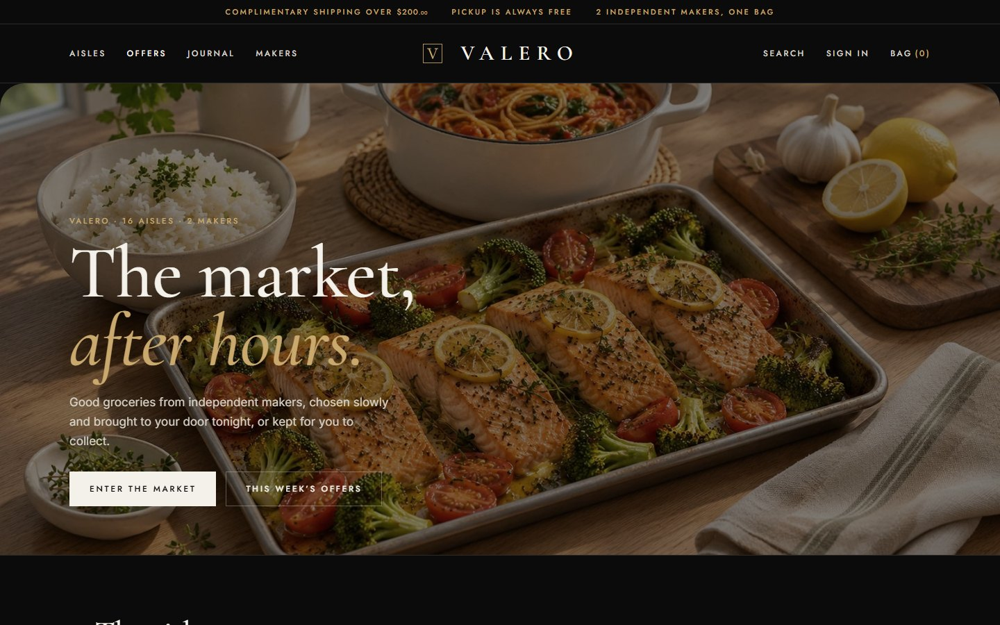
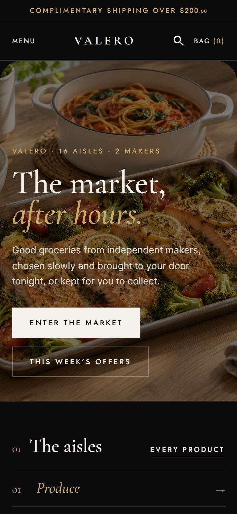
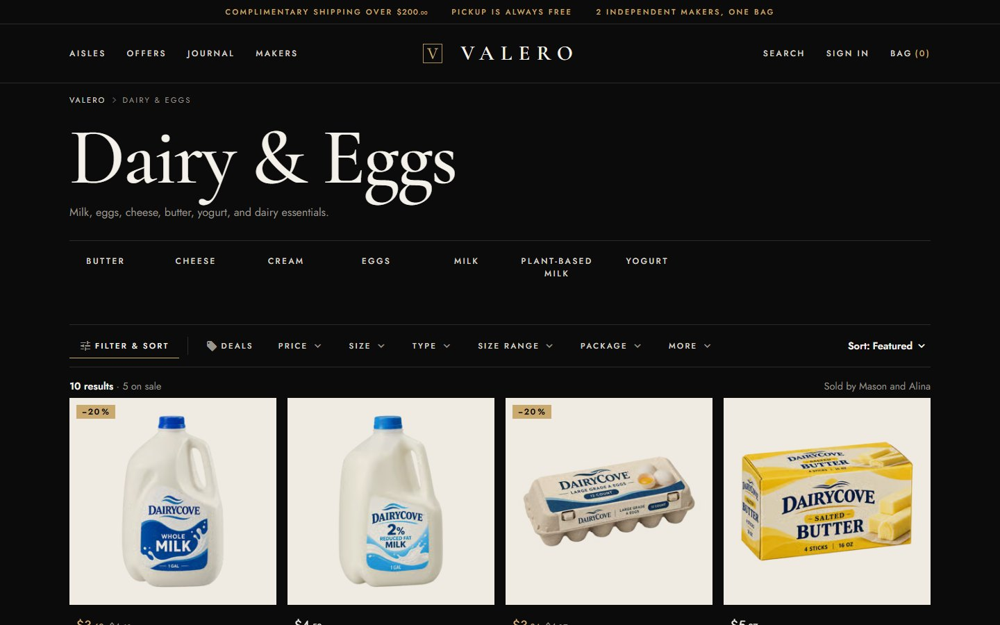
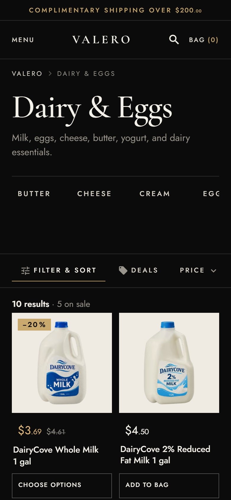
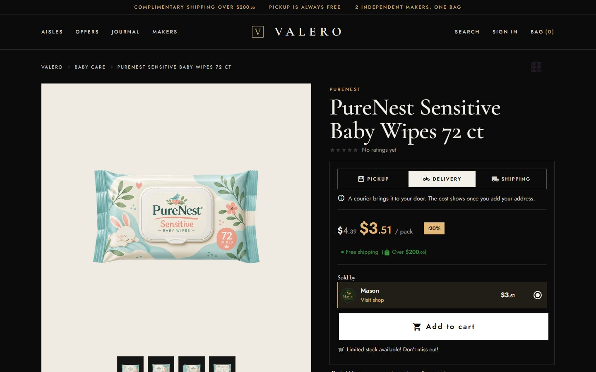
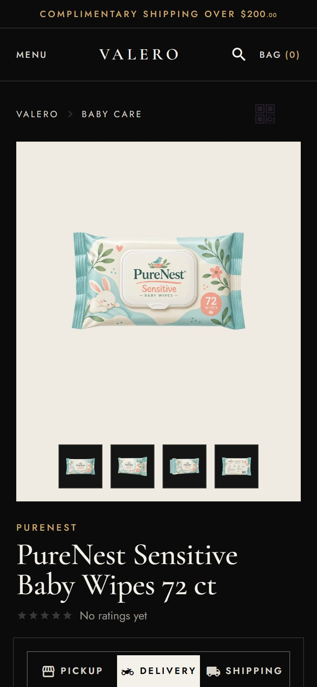
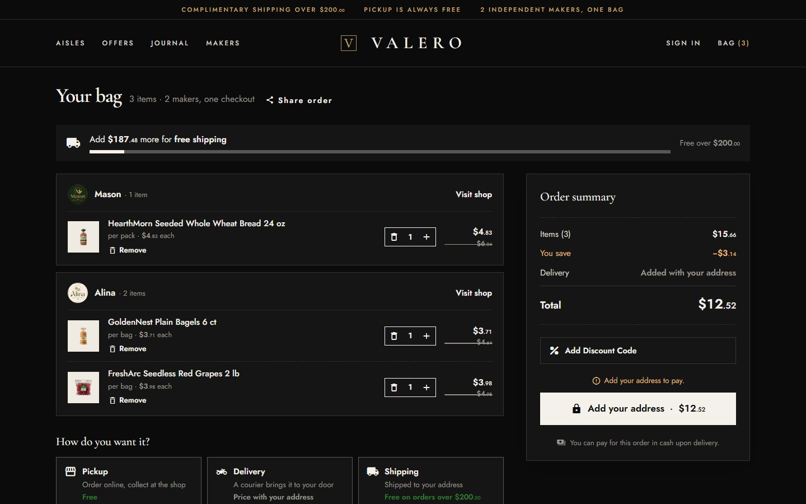
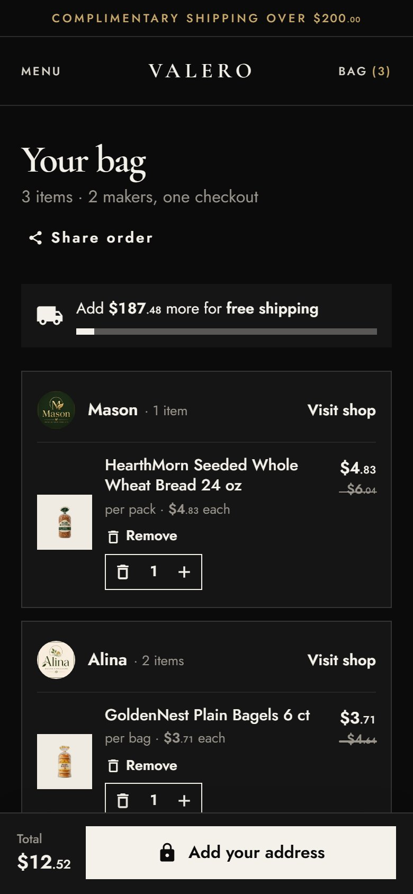

<p align="center">
  
</p>

<h1 align="center">Valero Market</h1>

<p align="center">
  <b>A black, after-dark food hall storefront for a Selldone grocery marketplace.</b><br>
  A custom Selldone Layout built on the official <a href="https://github.com/selldone/storefront">selldone/storefront</a>.
</p>

<p align="center">
  <a href="https://valero.selldone.shop"></a>
  <a href="https://github.com/selldone-custom-layouts/official-valero/wiki"></a>
  <a href="https://github.com/selldone-custom-layouts/official-valero/wiki/Install-with-AI"></a>
  
  
</p>

<p align="center">
  <a href="https://valero.selldone.shop"><b>Open the live shop</b></a> ·
  <a href="https://github.com/selldone-custom-layouts/official-valero/wiki/Install-with-AI">Set it up with AI</a> ·
  <a href="https://github.com/selldone-custom-layouts/official-valero/wiki/Manual-Setup">Manual setup</a> ·
  <a href="https://github.com/selldone-custom-layouts/official-valero/wiki/Shop-Requirements">What your shop needs</a> ·
  <a href="https://github.com/selldone-custom-layouts">All Selldone custom layouts</a>
</p>

---

## What it is

**Valero Market** dresses a grocery marketplace as an after-dark food hall:

- a black page with ivory type, champagne hairlines and small capitals;
- Cormorant Garamond headings and Jost text, square corners, no shadows;
- an editorial hero, the aisles as a numbered index, hairline grids of cards with packshots on ivory squares;
- a product page with the sellers as hairline rows and folding sections, a full-height bag panel, makers' pages, and a magazine-style journal.

It runs on **[valero.selldone.shop](https://valero.selldone.shop)**, another address of the same Selldone shop, molino. The shop's main address keeps its own Layout, [Molino Market Hall](https://github.com/selldone-custom-layouts/official-molino). Selldone lets each domain of a shop carry its own Layout.

Everything is read from the shop: products, prices, savings, sellers, aisles, delivery methods and articles. Nothing about molino is written into the code.

## Highlights, page by page

| Page | What you see |
| --- | --- |
| Header | A champagne announcement line (free-shipping rule, free pickup, the makers); Aisles (a numbered index of every aisle), Offers, Journal and Makers; the wordmark in spaced serif capitals; Search, Account and Bag (n) |
| Home | "The market, *after hours.*" over a dimmed photo; 01 The aisles; 02 This week's edit (the biggest savings); 03 Of the season; 04 The makers; 05 From the journal; the ways to get it |
| Aisle, catalogue, search | A very large serif title, the types as tracked words, one hairline filter bar, cards on ivory squares |
| Product | A serif title, the delivery choice, the sellers as hairline rows, "Add to bag", folding details, "Goes well with" |
| Bag | A full-height black panel, a free-shipping meter, View bag and Check out; the bag page with the summary and the map-first address sheet |
| Maker (seller) | "The maker", the name in very large serif, the mark in a champagne ring, their aisles and products |
| Journal, article, About, Terms, 404 | Typographic: big serif headings, hairline numbers, a magazine journal, "Not on the shelf." with an outlined 404 |
| Sign in | A split window: a dark photo with one serif line beside the shop's own ways in |

## Screenshots

| Desktop | Phone |
| --- | --- |
|  |  |
|  |  |
|  |  |
|  |  |

## Use it on your shop

| Wiki page | What it covers |
| --- | --- |
| [Install with AI](https://github.com/selldone-custom-layouts/official-valero/wiki/Install-with-AI) | A copy-paste prompt for Claude Code or Codex, and what only you do (CLI sign-in, 2FA) |
| [Manual Setup](https://github.com/selldone-custom-layouts/official-valero/wiki/Manual-Setup) | Fork, remotes, install, `.env`, dev server, the manifest |
| [Shop Requirements](https://github.com/selldone-custom-layouts/official-valero/wiki/Shop-Requirements) | The shop data the design needs |
| [Build and Upload](https://github.com/selldone-custom-layouts/official-valero/wiki/Build-and-Upload) | The release script and why each step exists |
| [Go Live](https://github.com/selldone-custom-layouts/official-valero/wiki/Go-Live) | Attaching the exact version, one Layout per domain, verification |
| [Customize](https://github.com/selldone-custom-layouts/official-valero/wiki/Customize) | Tokens, where each part is, rules that keep it working |
| [Troubleshooting](https://github.com/selldone-custom-layouts/official-valero/wiki/Troubleshooting) | Blank page, MIME, rejected uploads, old version showing |

## For developers

```bash
git clone https://github.com/selldone-custom-layouts/official-valero.git
cd official-valero
npm install
npm run serve          # dev server on the port in .env (VITE_APP_DEV_SERVER_PORT)
bash scripts/release.sh 1.0.1 desk   # build, check, package, upload (see the wiki)
```

## Where things are

| Part | Files |
| --- | --- |
| Tokens (colours, type, geometry) | `style/kalio-tokens.scss` |
| Vuetify's dark theme in Valero's colours | `storefront.ts` |
| Valero's look: base, header, footer, card, home | `style/valero-d.scss` |
| Valero's look: every other page | `style/valero-d-pages.scss` |
| Home | `components/valero/ValeroHome.vue`, `valero-home.ts` |
| Card and rows | `components/valero/ValeroCard.vue`, `ValeroRow.vue` |
| Header, phone menu, bag panel, footer, sign-in | `components/kalio/shell/` |
| Name and mark | `components/kalio/kalio-brand.ts`, `assets/brand/valero-mark.svg` |
| Photos | `assets/valero/` |
| Design notes and releases | [`VALERO.md`](VALERO.md), and [`KALIO.md`](KALIO.md) for every shared behaviour |

## Credits

Built on [selldone/storefront](https://github.com/selldone/storefront) (MIT). Selldone's original README is kept as [`README.selldone.md`](README.selldone.md). Started from [Tario Market](https://github.com/selldone-custom-layouts/official-tario), which started from [Molino Market Hall](https://github.com/selldone-custom-layouts/official-molino).

<!-- THEME:START -->
### Theme and colours

Choose Valero's colours in one file, `components/valero/valero-theme.settings.ts`:

- `palette`: ivory, gold, emerald, sapphire, rose;
- or `brandColor`: any `#RRGGBB`, made readable automatically (`textOnBrand: "auto"` keeps a light brand such as yellow, with dark words);
- `mode`: light or dark (dark is the default);
- `themeSwitcher`: showcase, on or off.

You can also tell your AI agent "use the yellow theme" or "make it light": `AGENTS.md` (section "Theme") tells it what to change. Then build and upload. See the wiki page [Theme and colours](https://github.com/selldone-custom-layouts/official-valero/wiki/Theme-and-colours).

The header's Theme button (palettes, Custom colour, Light / Dark) is a showcase feature. It shows only on Valero's own showcase shop (molino, Selldone shop 15645), so when you import Valero into your shop, your shoppers see Valero in its designed colours, with no Theme button. The Layout looks exactly as it does without the switcher, and any stored choice is ignored. To offer the switcher to your shoppers, set `themeSwitcher: "on"` in `components/valero/valero-theme.settings.ts`, then build and upload. `themeSwitcher: "off"` hides it everywhere.
<!-- THEME:END -->
