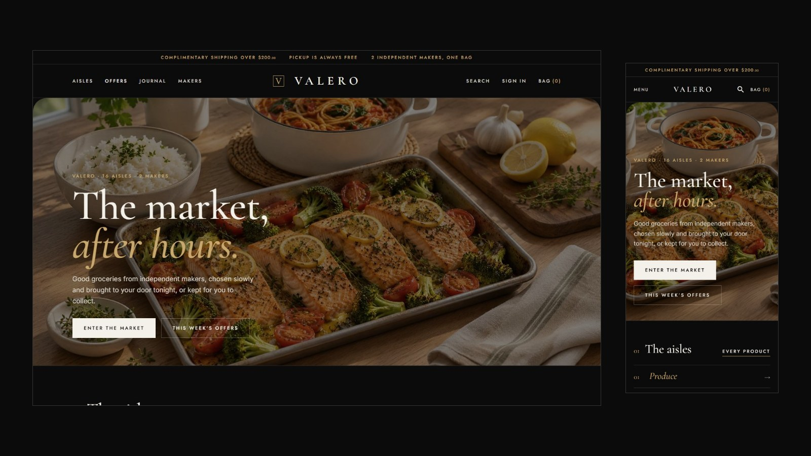

# Valero Market

**Valero Market** is a custom storefront **Layout** for Selldone shops: a multi-vendor grocery marketplace as an after-dark food hall: a black page with ivory type and champagne hairlines, an editorial hero, the aisles as a numbered index, hairline grids of cards on ivory squares, a split product page with the sellers as a table, a full-height bag panel, a numbered checkout and makers' pages, in Cormorant Garamond and Jost. It runs on **[valero.selldone.shop](https://valero.selldone.shop)**, a second address of the shop molino, whose main address carries [Molino Market Hall](https://github.com/selldone-custom-layouts/official-molino): one shop, one Layout per domain (see [Go Live](Go-Live)). It is built on the official [selldone/storefront](https://github.com/selldone/storefront), so Selldone's basket, checkout, payments, vendor offers and orders keep working underneath a completely new design.

## Start here

| I want to… | Page |
| --- | --- |
| Have an AI agent set it up on my shop | **[Install with AI](Install-with-AI)** |
| Set it up myself | [Manual Setup](Manual-Setup) |
| Know what my shop's data needs | [Shop Requirements](Shop-Requirements) |
| Build, upload and verify a release | [Build and Upload](Build-and-Upload) |
| Put it live on my shop and domain | [Go Live](Go-Live) |
| Change colours, fonts, sections, pages | [Customize](Customize) |
| Fix a problem | [Troubleshooting](Troubleshooting) |

## How a Selldone Layout works (one minute)

1. A **Layout** is a complete storefront app (Vue 3) that runs on Selldone's own servers instead of the default storefront.
2. You build it, zip it, and **upload** it to your Selldone developer account with the official [selldone-cli](https://github.com/selldone/cli). Each upload is a new **version**.
3. You **attach** a version to your shop: shop dashboard › Domains › Default layout › Change layout. Every domain of the shop can inherit it.
4. Selldone injects **your** shop into the Layout: its products, categories, sellers, prices, theme, languages and settings. Nothing about molino is hard-coded.

## What you get

- **Home:** a deals banner, two rows of aisles, a row of best sellers for every aisle, an aisle mosaic, seller cards and a market shelf.
- **Cards:** "Add to cart" turns into "− n in cart +" in place, "Choose options" for products with sizes, and the seller is named on every card.
- **Shop pages:** a compact aisle head, quiet filters built from product specs, one sort menu.
- **Product page:** gallery, details and a sticky buy box with every seller's offer.
- **Seller storefronts.**
- **Cart and checkout:** a cart drawer with the free-shipping meter and View cart / Check out; a cart page with a card per seller, "How do you want it?" tiles, a map-first address sheet and an order summary that leads to whatever is missing.
- **Orders:** the receipt, delivery, the trip and chat.
- **Buyer account:** in two designs.
- **Content pages:** journal, article, About, Terms and Privacy.

## Links

- Live shop: <https://valero.selldone.shop>
- Repository: <https://github.com/selldone-custom-layouts/official-valero>
- Design notes and release log: [`KALIO.md`](https://github.com/selldone-custom-layouts/official-valero/blob/main/KALIO.md)
- All official custom Layouts: <https://github.com/selldone-custom-layouts>
- Selldone: <https://selldone.com>
